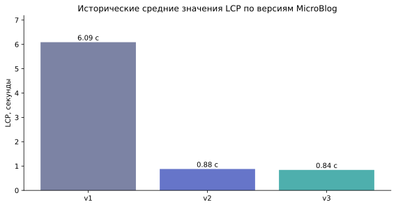

# Результаты исследования

> Источник: сводные таблицы НИР, этап 2. Это архивные данные, а не новый эксперимент.

| Версия | Score | LCP, c | FCP, c | TBT, мс | CLS | SI, c |
|---|---|---|---|---|---|---|
| v1 | 75.3 | 6.09 | 0.87 | 134 | 0 | 2.16 |
| v2 | 98.6 | 0.88 | 0.86 | 94 | 0 | 2.42 |
| v3 | 99.0 | 0.84 | 0.84 | 112 | 0 | 1.42 |

## Интерпретация

По сводным измерениям v2 и v3 значительно быстрее базовой реализации по LCP. Однако несколько оптимизаций изменялись одновременно, поэтому причинный вклад отдельно WebP, lazy loading и AVIF этим сравнением не установлен.

## Происхождение данных и воспроизводимость сборки

- SHA-256 исходного CSV: `3e328cb8ea01dfe510d64c27a25d53ec002d17cdb6efcb0caeb027be2f253bf9`.
- Версия исходного кода (Git): `13a5a7f`.
- Сборка с одинаковым CSV и генератором должна создавать одинаковые числовые таблицы. Дата сборки намеренно не вшита в Markdown для детерминированности.

Первичные измерения, условия теста и ограничения см. в отчёте НИР, этап 2.
